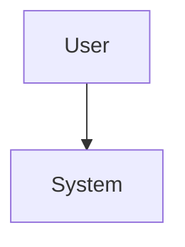
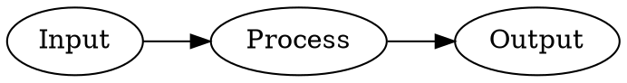

# Diagramming (Mermaid, Graphviz DOT, draw.io)

## Motivation / background

Chat answers often need structure diagrams. The app supports three diagram formats that the model can emit in normal markdown (or under the Diagram / Deep Learn paths):

1. **Mermaid** — flows, sequence, mindmaps; client-side mermaid.js
2. **Graphviz DOT** — dependency graphs, trees, FSMs, precise layout; client-side [@viz-js/viz](https://github.com/mdaines/viz-js) (Graphviz in WASM)
3. **draw.io / diagrams.net XML** — richer editable diagrams; saved as conversation artifacts with edit/download links

Diagramming is **not one agent**. Separate paths *prompt*, *stream*, and *render*.

---

## How the user turns it on

| Surface | Effect |
|---|---|
| Settings preamble **Diagram** (`/preamble_diagram`) | Appends `diagram_instructions` into the system/preamble for that turn. Model is guided to emit Mermaid, Graphviz DOT, and/or ASCII (and may choose draw.io when appropriate). |
| Slash **`/draw`** | Sets `checkboxes.draw` → `need_diagram=true` and a short permanent instruction that the user requested diagrams (weaker than full `diagram_instructions`). |
| Settings preamble **Deep Learn** | Teaching system on the main answer **plus** parallel Visual tab generation (`visual_tab_prompt`: ASCII + Mermaid and/or DOT). |
| Temp LLM **Explain visually** / multi-select **Run Preamble** style actions that use `explain_visual` | Same three-format guidance for a selection. |
| No special flag | Still works if the model emits fenced `mermaid` / `dot` / drawio XML on its own — render path is opportunistic. |

---

## Format reference (what the LLM should emit)

### Mermaid

````markdown

````

Strict label rules live in `diagram_instructions` / `visual_tab_prompt` (quote labels with punctuation, avoid lowercase `end` as id, plain ASCII, etc.).

### Graphviz DOT

Language tags accepted: **`dot`**, **`graphviz`**, **`gv`**.

````markdown

````

Guidance (same substance as prompts):

- Prefer `digraph` for directed graphs, `graph` for undirected; name like `G`.
- Quote labels with spaces/punctuation: `A [label="compute f(x)"];`.
- One statement per line; end with `;`; plain ASCII.
- Simple attrs only (shape, label, rankdir, color, style, fontsize). Avoid HTML labels (`label=<...>`), external images, and arbitrary URLs.

### draw.io

XML inside triple-tick fences (` ```xml ` or extractable mxGraph / mxfile content). Server extracts and writes conversation docs + injects a render div.

### ASCII art

Plaintext code block — preferred when the Diagram instructions say “faster / simple” and no interactive layout is needed.

---

## End-to-end pipeline

### 1) Prompt injection (server)

| Path | File / symbol | What gets added |
|---|---|---|
| Diagram preamble | `Conversation.get_preamble` if `"Diagram" in preamble_options` | `diagram_instructions` from `prompts.json` (source of truth written from `create_base_prompts.py` via `manager["diagram_instructions"] = ...`) |
| `/draw` | `Conversation.reply` sets `need_diagram` | Permanent instruction: user requested diagrams |
| Deep Learn | `preamble_deep_learn` + parallel `_visual_tab_future` | Teaching style + `visual_tab_prompt` (ASCII + Mermaid and/or DOT) |
| Temp explain visual | `Conversation.temporary_llm_action` → `explain_visual` | Selection-focused ASCII + Mermaid and/or DOT |

Prompt definitions:

- `create_base_prompts.py` → `diagram_instructions` (synced into `prompts.json`)
- `prompts.py` → `visual_tab_prompt`, also loads `diagram_instructions = manager["diagram_instructions"]`
- `Conversation.py` → `explain_visual` string

### 2) Stream artifacts (server, mermaid / draw.io)

During streaming, `_process_stream_artifacts` in `Conversation.py` periodically:

- **draw.io**: `extract_drawio` → save XML under conversation docs path → emit  
  `<div class="drawio-diagram" data-diagram-url="...">` plus edit/download links.
- **Mermaid**: `extract_last_mermaid` + `normalize_mermaid_text` / `sanitize_mermaid_syntax` (`code_runner.py`) → re-emit cleaned fenced / pre-wrapped mermaid for client re-render.

**Graphviz DOT has no server extract/re-emit path (YAGNI).** Fenced ` ```dot ` content streams as normal markdown and is rendered entirely client-side.

### 3) Markdown → diagram shell (client)

`interface/common.js` → `markdownParser.code`:

| language | DOM shell |
|---|---|
| `mermaid` | `<div class="code-block mermaid-container"><pre class="mermaid">…</pre><details>Mermaid source…</details></div>` |
| `dot` / `graphviz` / `gv` | `<div class="code-block graphviz-container"><pre class="graphviz">…</pre><details>DOT source…</details></div>` |

Other fenced languages go through highlight.js as usual.

Temp-LLM / doubt paths that call default `marked.parse` without `markdownParser` produce `<pre><code class="language-dot">`. `renderGraphvizIn` **promotes** those to `pre.graphviz` before rendering so they still work.

### 4) Client render

| Format | Loader | Render API |
|---|---|---|
| Mermaid | Eager mermaid.js (page head) | `renderMermaidIn($container)` — skip already-SVG / failed; on error **Fix Diagram** via `/temporary_llm_action` |
| Graphviz DOT | **Lazy** `LazyLibs.loadViz()` → `@viz-js/viz@3.11.0/lib/viz-standalone.js` | `renderGraphvizIn($container)` → `Viz.instance()` then `viz.renderSVGElement(dot, { engine: 'dot', format: 'svg' })`; on error **Fix DOT Diagram** |
| draw.io | **Lazy** `LazyLibs.loadDrawio()` | Existing drawio-renderer on `.drawio-diagram` nodes |

Call sites for Mermaid + Graphviz (keep in sync when adding new answer UIs):

- End of markdown render idle path (`renderInnerContentAsMarkdown` parent)
- Stream done + history post-render (`common-chat.js`)
- Multi-model / TLDR / Visual tab show + active pane (`applyModelResponseTabs`)
- `<details>` open handlers (`renderMermaidIfDetailsTagOpened` also calls Graphviz)
- Doubt modal + Temp LLM streams

Sanitizers:

- Mermaid: Python `code_runner.sanitize_mermaid_syntax` / JS `sanitizeMermaidSyntax` + `cleanMermaidCode` (keep in sync if either changes).
- DOT: JS-only `cleanGraphvizCode` (strip fences, HTML wrappers, smart quotes).

### 5) Deep Learn Visual tab

1. Start of `reply` (Deep Learn, no specialized agent): fire `_visual_tab_future` with `visual_tab_prompt` on `quick_action_model` / `QUICK_ACTION_LLM`.
2. After main answer: only if `answer_word_count > 200` and future returns >50 chars → wrap in:

```html
<answer_visual>
…markdown with ASCII / mermaid / dot…
</answer_visual>
```

3. Frontend:
   - pre-marked: `<answer_visual>` → comment placeholders (so marked still parses markdown inside)
   - post-marked: → `<div data-answer-visual="true">`
   - `applyModelResponseTabs()` builds **🎨 Visual** tab (alongside Main / TLDR / multi-model)
4. Pure Visual (Deep Learn, single model, no TLDR) early-return previously skipped tabs; fixed gate now includes `!hasVisualWrapper` so **Main | 🎨 Visual** builds after stream end. `UI_CACHE_VERSION` bumps invalidate IndexedDB snapshots.

Visual content may contain both Mermaid and DOT; each is rendered when the Visual pane is shown.

---

## UX summary

| Want | Toggle / action |
|---|---|
| Diagrams **in** the main answer | **Diagram** and/or `/draw` |
| Teaching style + side Visual panel | **Deep Learn** (best when answer > ~200 words) |
| Graphviz specifically | Prompt for dependency/hierarchy diagrams, or rely on Diagram / Visual instructions preferring DOT for those shapes |
| Fix broken Mermaid | **Fix Diagram** on the block |
| Fix broken DOT | **Fix DOT Diagram** on the block |

---

## Implementation notes / files

| Layer | Files |
|---|---|
| Prompt source | `create_base_prompts.py` (`diagram_instructions`), `prompts.py` (`visual_tab_prompt`), `prompts.json` (runtime `diagram_instructions`) |
| Preamble / stream | `Conversation.py` (`get_preamble`, `need_diagram`, `_visual_tab_future`, collect visual, `_process_stream_artifacts`, `explain_visual`) |
| Mermaid extract/sanitize (server) | `code_runner.py` (`extract_mermaid`, `extract_last_mermaid`, `normalize_mermaid_text`, `sanitize_mermaid_syntax`) |
| Lazy libs | `interface/lazy-libs.js` — `LazyLibs.loadViz()`, `LazyLibs.loadDrawio()` |
| Markdown + render | `interface/common.js` — `markdownParser.code`, `renderMermaidIn`, `renderGraphvizIn`, `cleanGraphvizCode`, `applyModelResponseTabs`, UI_CACHE version |
| Stream / history hooks | `interface/common-chat.js` |
| Doubt / temp | `interface/doubt-manager.js`, `interface/temp-llm-manager.js` |
| Docs cross-links | this file; `conversation_flow.md`; `product/behavior/chat_app_capabilities.md` §9; multi-model tabs doc for Visual tab |

---

## Verification notes

There is no dedicated diagram unit suite. Ad-hoc checks used during Graphviz work:

- `node --check` on `common.js`, `common-chat.js`, `lazy-libs.js`, doubt/temp managers
- Static greps for prompt strings + render hooks
- Decision-table style checks for language aliases (`dot`/`graphviz`/`gv`), fence stripping, pure Visual tab early-return

Browser smoke (manual): hard-reload (UI cache version bump), enable Diagram, ask for a dependency graph in DOT — expect SVG + collapsible DOT source.
